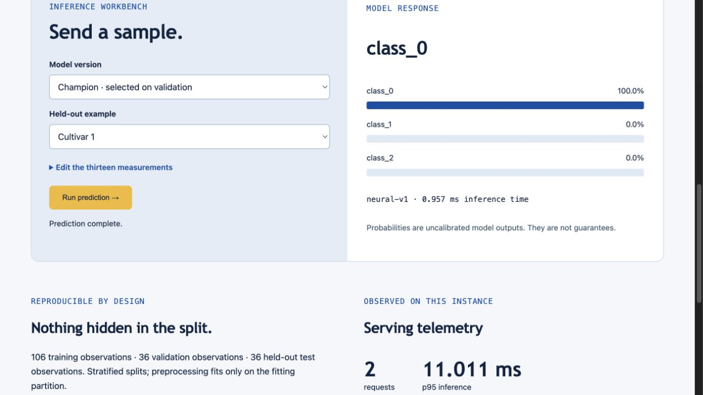
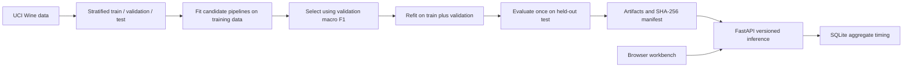

# Model Deck

**Build status:** Local rebuild with tested training, inference, CSV upload and drift monitoring. This version is not deployed. Previous similarly named hosted applications do not demonstrate this rebuild.

**An experiment-to-endpoint workbench: train, compare, version, and serve three real classifiers.**

Model Deck makes the delivery side of machine learning visible. A reviewer can inspect validation and test scores, choose a model version, edit a sample, and call the same inference endpoint used by the interface. No provider key is needed. It now includes CSV batch prediction and statistical input-distribution monitoring against a training-only reference.



## Why build this?

A notebook score does not show how a model becomes an application. This project connects training, selection, artifact identity, input validation, batch inference, and operational measurements in one reproducible workflow.

The example task classifies wine cultivars from thirteen chemical measurements using scikit-learn's UCI Wine dataset. It is a small educational benchmark, not a wine-quality estimator or an industrial deployment claim.

## Run locally

Python 3.12 is recommended.

```bash
uv venv --python 3.12
source .venv/bin/activate
uv pip install -r requirements.txt
python train.py
uvicorn app:app --host 127.0.0.1 --port 8000
```

Open `http://127.0.0.1:8000` for the workbench or `/docs` for the interactive API reference. The first startup can train missing artifacts; deployment explicitly trains them during the build.

## What should a recruiter try?

1. Compare the registry cards. The validation champion is deliberately retained even when a different candidate scores higher on the held-out test.
2. Choose a held-out example and model version. Run a prediction and inspect probabilities and measured inference time.
3. Edit a measurement and repeat. Inspect the manifest to see feature order and exact split membership.
4. Download the CSV example, upload it and compare its three predictions with the individual workbench results. CSV headers can be reordered; quoted fields and UTF-8 BOMs are supported.
5. Submit 30–100 CSV rows to inspect distribution shift. Feature-level KS statistics, corrected p-values and range violations show why an alert was generated.
6. Send a malformed request through `/docs`; it should be rejected before inference. Invalid files do not add successful-call telemetry.

## Architecture



Models: standardized logistic regression, random forest, and a small neural network with two hidden layers (24 and 12 units). Preprocessing is fitted inside each pipeline on its fitting partition. The neural model demonstrates basic neural-network training; this does not imply LLM training experience.

## Measured results

The committed [manifest](artifacts/manifest.json) records the generated results, runtime versions, dataset fingerprint, split indices, and model digests. Run `python train.py` to reproduce them under the pinned dependencies. Floating-point results can vary across platforms.

On the initial local run (106 training, 36 validation, 36 test observations), neural-v1 won validation selection with macro F1 1.000 and achieved test accuracy 0.944. Linear-v1 achieved 0.972 test accuracy; forest-v1 achieved 1.000. The majority-class baseline achieved 0.389. These small-sample results have substantial uncertainty. We do not switch the champion based on its test result, and the 100% forest score is not evidence of perfect real-world performance.

## API

| Route | Purpose |
|---|---|
| `GET /healthz` | Readiness and loaded-model count |
| `GET /api/registry` | Model versions, scores, provenance, split indices |
| `GET /api/samples` | Disclosed held-out examples |
| `POST /api/predict` | Up to 100 rows, each with 13 finite measurements |
| `GET /api/metrics` | Latest 2000 calls; aggregate inference timing |
| `POST /api/predict-csv?model_id=champion` | UTF-8 CSV body; 128 KiB and 100-record limits; exact named columns |
| `POST /api/drift` | JSON rows: 30–1000 samples compared with original training partition |
| `POST /api/drift-csv` | Same CSV parser, 30–100 records; feature-level shift evidence |

Example body: `{"model_id":"champion","rows":[[14.23,1.71,2.43,15.6,127,2.8,3.06,0.28,2.29,5.64,1.04,3.92,1065]]}`. `model_id` can also be `linear-v1`, `forest-v1`, or `neural-v1`.

## Distribution monitoring and reproducibility

`monitoring.py` compares incoming measurements with the original **106 training observations**, excluding validation and test rows from the reference. It applies a two-sided, two-sample Kolmogorov–Smirnov test to each of thirteen features, using asymptotic p-values and Bonferroni correction for a 0.05 family-wise threshold. Responses include effect size (KS statistic), corrected p-value, standardized mean movement and values outside the observed training range. No raw uploaded feature rows are persisted.

The endpoint is input-distribution monitoring, not a model-accuracy measurement. It assumes independent observations; very small batches have low power, while correlated or duplicate traffic can invalidate inferential interpretations. It cannot detect every joint-distribution change, label shift or concept drift. Alerts require investigation, not automatic retraining.

The [reproducible synthetic check](docs/drift-evaluation.json) uses 40 seeded bootstrap batches of 100 rows from the finite training reference, paired with a large (+5 training standard deviations) shift injected into one rotating feature. This local run flagged **0/40 stable batches**, **40/40 injected batches**, and localized only the injected feature in **40/40** cases. These are deliberately synthetic stress conditions, not a production false-alarm rate or a comparison against another product. Reproduce with:

```bash
python scripts/evaluate_drift.py
```

Manifest schema 2 records source SHA-256 digests for training, API and monitor code, plus dataset identity, runtime versions, selection/refit policy and training-reference summary. This supports inspection and reproduction; a hash is not a signed supply-chain attestation. Train again after modifying source to regenerate the manifest.

## Engineering decisions and limitations

- **Why a small dataset?** Training is quick, deterministic, and inspectable. Serving and release discipline are the focus. A larger independent dataset is needed for external validity.
- **Why no arbitrary model upload?** Python serialized artifacts can execute code. The service loads only project-generated artifacts checked against the build manifest. Hashes detect mismatch; they do not authenticate an attacker-controlled manifest. The build source remains trusted.
- **Why one worker?** This bounded demo uses local SQLite for aggregate telemetry. Multi-instance serving needs a shared metrics store, authentication, rate limiting and load testing.
- **What persists?** The free-hosting filesystem can be reset on deploy/restart. Metrics are demonstration telemetry, not a durable service history. Input feature rows are not stored.
- **What does latency mean?** Model inference inside the process, excluding network and cold-start latency. p95 is calculated from the latest retained calls, not a throughput benchmark.
- **What about AWS?** The architecture is inspired by containerized inference, but this project does not claim verified Lambda deployment. The supplied Docker and Render configuration are its supported deployment paths.

## Verification and deployment

```bash
uv pip install pytest httpx
python -m pytest -q
python scripts/evaluate_drift.py
node --check static/app.js
docker build -t model-deck .
docker run --rm -p 8000:8000 -e PORT=8000 model-deck
```

Seven tests cover disjoint partitions and validation-only selection; measured baseline comparison; source and training-reference provenance; real versioned prediction contracts; targeted drift localization and null behavior; batch-size/shape rejection; quoted/reordered/BOM CSV parity with JSON inference; and bounded upload/error handling without inference side effects. The CSV rejection test includes empty input, missing/duplicate columns, ragged records, oversized batches, invalid encoding, NaN, infinity, formula-like text, out-of-bound magnitudes, oversized bodies and unsupported media types. CI runs tests and builds the container. `render.yaml` describes a free Python service. A live URL should be added only after successful remote deployment and smoke checks.

## Ownership, inspiration, and skills

An original implementation for Deepak Gangwar's portfolio, developed with AI assistance. [SeamlessML](https://github.com/newtonjain/Docker_Hackathon) inspired the model-packaging and serving problem; no upstream code, model weights, notebooks, or UI were copied. Its original authors' award is not this project's achievement. See [reference analysis](docs/reference-analysis.md).

Demonstrated skills: Python, REST APIs, software design, Machine Learning, a small feedforward neural network, model selection, data processing, MLOps foundations, Git/CI, statistical monitoring, bounded file processing, testing, and technical documentation. No enterprise users, business savings, or production reliability figures are claimed.

Dataset attribution: UCI Wine recognition, distributed through scikit-learn; see `sklearn.datasets.load_wine().DESCR` for the original dataset description and references. Source code: MIT [license](LICENSE).

## Original project study

See the [upstream project study](docs/upstream-study.md) for the original architecture, authorship, setup requirements and limitations. It describes a separate upstream reference, not this repository’s deployed application.

## Comparison boundary

This rebuild adds locally tested training provenance, CSV serving and statistical monitoring to the earlier independent implementation. The upstream SeamlessML examples target AWS serverless inference; this project has not demonstrated superior cold-start latency, cost, throughput or scalability. No side-by-side runtime benchmark or verified AWS deployment has been performed. Its independently measured scope is the included Wine model task and explicitly synthetic drift scenarios.
